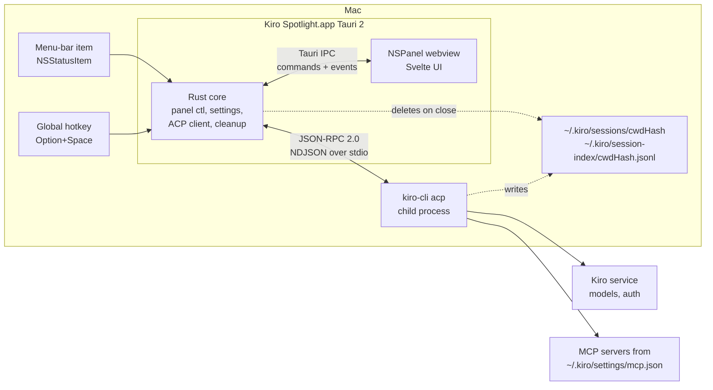
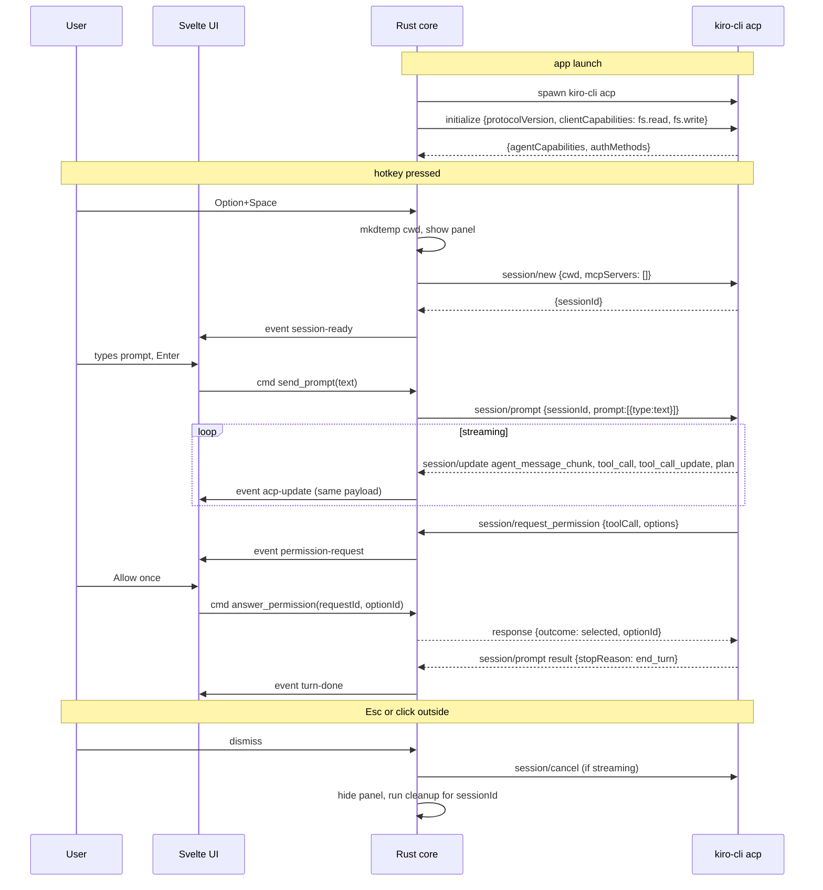

# Kiro Spotlight: Architecture Spec

Version 0.2, 2026-11-07. Status: draft for review.

## 1. Goal

A macOS menu-bar app that opens a Spotlight-style floating panel on a global hotkey, lets the user chat with Kiro (same login, models, tools and MCP servers as `kiro-cli`), and leaves no trace of the conversation when the panel is dismissed.

Non-goals for v1: voice wake word, multi-window, chat history, file attachments beyond paste, Windows/Linux.

## 2. Constraints and decisions

| Topic | Decision | Why |
|---|---|---|
| Shell | Tauri 2 (Rust core, web UI) | Small binary, native WebKit, Rust owns the agent process |
| Agent backend | `kiro-cli acp` child process, JSON-RPC 2.0 over stdio (ACP) | Officially supported integration path; inherits `kiro-cli login`, agents, MCP servers |
| Engine | Plain `kiro-cli acp`, no `--agent` | The only invocation that supports `session/delete` and `session/list` (section 4.3) |
| Window | Real `NSPanel` via `tauri-nspanel` plugin, non-activating, floating level, joins all Spaces incl. fullscreen | Standard Spotlight behaviour; a plain NSWindow steals focus and does not overlay fullscreen apps |
| Hotkey | `tauri-plugin-global-shortcut`, default Option+Space, user-configurable | Matches ChatGPT desktop default |
| UI look | macOS structure (NSPanel, vibrancy, SF Pro, Spotlight geometry) with colours taken from the user's selected Kiro theme, live-reloaded (section 6.1) | Feels native on macOS and consistent with Kiro |
| Incognito | Ephemeral session: temp cwd, in-memory transcript, delete kiro-cli session records on close | kiro-cli persists sessions to disk; the app must undo that (section 7) |
| Tool safety | Default agent with `autopilot: off`, so commands and writes prompt (section 4.3) | A hotkey panel should not silently write files or run shell |
| Front-end | TypeScript + Svelte (or React), Vite, no CSS framework; `marked` + `shiki` for Markdown/code | Keep the bundle small and styling hand-tuned to macOS |

## 3. System overview



## 4. Components

### 4.1 Rust core (`src-tauri/`)

```
src-tauri/
  src/
    main.rs            app setup, plugins, shortcut registration, run loop
    panel.rs           NSPanel creation, show/hide, positioning, appearance
    tray.rs            menu-bar item: Open, New Chat, Quit
    commands.rs        Tauri commands for the UI
    acp/
      protocol.rs      JSON-RPC framing, ACP params and permission outcomes
      connection.rs    child process, request correlation, inbound dispatch
    session.rs         SessionManager: agent lifecycle, session options, cleanup, recovery
    cleanup.rs         temp cwds, pending-cleanup record, kiro-cli store sweep
    cli.rs             kiro-cli discovery, login-shell PATH, session options
    settings.rs        hotkey, model, theme source, idle minutes, cli path
    theme/
      mod.rs           resolve active theme
      ide.rs           Kiro IDE settings.json + theme extension JSON
      crew.rs          Kiro Crew config.json + dashboard stylesheet
      palette.rs       colour maths and token-to-palette mapping
      watch.rs         debounced file watcher
    live_tests.rs      ignored tests against the real kiro-cli
  tauri.conf.json
  capabilities/default.json
  Info.plist           LSUIElement (menu-bar only)
```

Responsibilities:

- **panel.rs**: converts the main `WebviewWindow` to an `NSPanel` with `nonactivatingPanel` style, level `NSFloatingWindowLevel`, collection behaviour `fullScreenAuxiliary | moveToActiveSpace`. Centres horizontally at ~22% from the top of the screen with the mouse cursor. Hides on Esc (and ends the conversation), on hotkey toggle, and on `resignKey` (click outside, conversation kept).
- **acp/connection.rs**: one child `kiro-cli acp` per app run (not per panel open) to keep latency low, started lazily on the first message and restarted on the next one if it exits. stdout is read line by line; stderr is discarded.
- **session.rs**, ACP side: `initialize` on start; `session/new` per panel open; `session/prompt` per message; `session/cancel` on stop. Dispatches `session/update` notifications to the UI as Tauri events. Answers agent-to-client requests: `session/request_permission` (routed to UI); anything else, including `fs/*` and `terminal/*`, gets `-32601` because neither capability is advertised. Kiro extension notifications (`_kiro/*`) are ignored.
- **session.rs**, cleanup side: see section 7.
- **settings.rs**: see section 10. Nothing conversational is ever stored there.

### 4.2 Web UI (`src/`)

```
src/
  App.svelte            panel root, keyboard handling, state machine
  lib/
    acp.ts              typed wrappers over Tauri commands and events
    markdown.ts         marked + shiki, sanitised with DOMPurify
    theme.css           macOS tokens: vibrancy, -apple-system, accent colour, dark mode
  components/
    Composer.svelte     single-line input that grows to 6 lines, Enter sends, Shift+Enter newline
    Transcript.svelte   streamed assistant text, tool-call rows, plan rows
    ToolCallRow.svelte  collapsed by default, status icon, expand for args/output
    PermissionCard.svelte  Allow once / Allow always (this session) / Deny
    StatusBar.svelte    model, effort, token spinner, "Incognito" badge, Stop button
    Settings.svelte     hotkey recorder, agent/model/effort pickers, engine toggle
```

Panel states: `idle` (composer only, 560x56 px), `streaming` (transcript grows to max 560x640 px, then scrolls), `permission` (card pinned above composer), `error`.

### 4.3 Session options (no custom agent profile)

An earlier draft shipped a `kiro-spotlight` agent profile and started `kiro-cli acp --agent kiro-spotlight`. Probing kiro-cli 3.1.0 showed that passing any `--agent` (with engine v2 or v3) starts an engine that advertises no `sessionCapabilities`, so `session/delete` and `session/list` return `-32601`. Incognito cleanup depends on both, so the app runs plain `kiro-cli acp` with the default agent (`vibe` mode) and writes nothing to `~/.kiro/agents`.

Lock-down comes from per-session config options instead, set with `session/set_config_option` right after `session/new`. If any of them fails, the session is deleted and not used:

| `configId` | Value | Effect (verified) |
|---|---|---|
| `autopilot` | `off` | Shell commands and file writes arrive as `session/request_permission` (options `accept`, `always-accept`, `reject`, `always-reject`) |
| `contentCollection` | `disabled` | Conversation is not used for content collection |
| `memoryReflection` | `off` | Conversation is not reflected into Kiro memory |
| `model` | user setting | Only sent when the user picked a model |

MCP servers come from the user's `~/.kiro/settings/mcp.json` through the default agent, so the panel has the same reach as the CLI.

## 5. ACP message flow



Details:

- Transport is newline-delimited JSON-RPC 2.0; one message per line, no embedded newlines ([ACP transport](https://agentclientprotocol.com/protocol/v1/session-setup)).
- `mcpServers: []` in `session/new` because MCP comes from the user's `mcp.json` through the default agent, not from the client.
- `session/new` is followed by `session/set_config_option` calls for the options in section 4.3.
- A prompt sent while a turn is streaming is queued in the UI and sent after `turn-done`; the Stop button sends `session/cancel`.
- Pasted images are sent as `{type: "image", data, mimeType}` content blocks if `agentCapabilities.promptCapabilities.image` is true; otherwise the paste is rejected with a toast.

## 6. Native look and feel

- **Material**: panel background is transparent; Rust attaches an `NSVisualEffectView` (material `.hudWindow` in dark, `.popover` in light, blending `behindWindow`) so the panel blurs whatever is behind it like Spotlight.
- **Shape**: 12 px corner radius on the panel; no title bar, no traffic lights, no resize handles (`decorations: false`, `resizable: false`, `transparent: true`).
- **Typography**: `font-family: -apple-system, BlinkMacSystemFont`, 15 px body, 13 px secondary, SF Mono for code via `ui-monospace`.
- **Colour**: all colours come from the active Kiro theme (section 6.1) as CSS variables. The vibrancy material follows the theme's light/dark kind, and the theme background is applied at ~85% opacity over it so the blur still shows through. macOS system colours are used only when no Kiro theme can be resolved.
- **Motion**: panel fades/scales in over 120 ms with `ease-out`, matching Spotlight; respects `prefers-reduced-motion`.
- **Keyboard**: Esc hides; Cmd+, opens settings; Cmd+K clears the conversation (new session); Cmd+Shift+C copies the last answer; Up arrow recalls the last prompt within the current session only.
- **Menu bar**: `NSStatusItem` with template icon, menu: Open (hotkey shown), New conversation, Settings, Quit. The app has no Dock icon (`LSUIElement = true`).
- **Icons**: SF Symbols rendered through Rust (`NSImage(systemSymbolName:)` to PNG at launch) or a bundled subset of equivalent SVGs. No emoji anywhere in the UI.

### 6.1 Following the Kiro theme

The panel uses whatever theme the user picked in Kiro and switches live when they change it.

**Sources, in resolution order** (configurable in settings as `theme_source`: `auto` | `kiro-ide` | `kiro-crew` | `system`; `auto` walks this list):

| # | Source | Where | What is read |
|---|---|---|---|
| 1 | Kiro IDE | `~/Library/Application Support/Kiro/User/settings.json` (JSONC) | `workbench.colorTheme`; if `window.autoDetectColorScheme` is true, `workbench.preferredLightColorTheme` / `workbench.preferredDarkColorTheme` picked by current macOS appearance |
| 2 | Kiro Crew | `~/.kiro/crew/config.json` | `theme_color` (e.g. `rosepine`) and `theme_mode` (`light` / `dark` / `system`) |
| 3 | macOS | `NSApp.effectiveAppearance`, `NSColor.controlAccentColor` | system label, separator and accent colours |

**Kiro IDE theme lookup** (`kiro_ide.rs`):

1. Take the theme label, e.g. `Rosé Pine Dawn`.
2. Scan `package.json` of each extension in `~/.kiro/extensions/*/` and of the built-in themes in `/Applications/Kiro.app/Contents/Resources/app/extensions/theme-*/` for a `contributes.themes[]` entry whose `label` (or `id`) matches.
3. Load the referenced theme JSON (JSONC, may use `include` to chain a parent theme; follow it). `uiTheme` gives the kind: `vs` = light, `vs-dark` = dark, `hc-*` = high contrast.
4. Read the `colors` map. Missing tokens fall back to the VS Code defaults for that kind.

**Kiro Crew lookup** (`kiro_crew.rs`): Kiro Crew defines each theme as CSS variables under `[data-theme=<theme_color>-light]` and `[data-theme=<theme_color>-dark]` in its dashboard stylesheet (`KiroCrew.app/.../kiro_crew/static/dist/assets/*.css`). The app reads those two blocks for the configured `theme_color` and maps `--bg`, `--text`, `--muted`, `--accent`, `--accent-fg`, `--border`, `--danger`, `--bg-elevated` onto its own variables. `theme_mode: system` sends both palettes and the UI picks one with `prefers-color-scheme`. A missing app or theme id falls through to macOS.

**Token mapping** (`palette.rs`), VS Code token to CSS variable:

| CSS variable | Primary token | Fallbacks |
|---|---|---|
| `--bg` | `editor.background` | `sideBar.background` |
| `--fg` | `editor.foreground` | `foreground` |
| `--fg-muted` | `descriptionForeground` | `--fg` at 65% |
| `--accent` | `button.background` | `focusBorder` (opaque), `textLink.foreground` |
| `--accent-fg` | `button.foreground` | `--bg` |
| `--input-bg` | `input.background` | `--bg` |
| `--border` | `widget.border` | `panel.border`, `--fg` at 12% |
| `--link` | `textLink.foreground` | `--accent` |
| `--error` | `errorForeground` | `editorError.foreground` |
| `--code-bg` | `textCodeBlock.background` | `--input-bg` |
| `--selection` | `editor.selectionBackground` | `--accent` at 25% |

Colours with alpha (e.g. `#6e6a8614`, `#0000`) are composited over `--bg` before use so no token renders invisible. Contrast between `--fg` and `--bg` is checked (WCAG AA 4.5:1); on failure `--fg` falls back to the theme kind's default.

**Syntax highlighting**: the same theme JSON's `tokenColors` is passed to `shiki` as a custom theme, so code blocks match the editor.

**Live updates** (`watch.rs`): `notify` watches the two settings files and the resolved theme file; macOS appearance changes come from observing `AppleInterfaceThemeChangedNotification`. On change, Rust re-resolves (debounced 200 ms) and emits a `theme-changed` event with the full palette; the UI swaps CSS variables on `:root` with a 150 ms transition. The theme is also resolved once at launch and sent before the panel's first paint to avoid a flash.

**Observed on this machine (2026-11-07)**: Kiro IDE `workbench.colorTheme` = `Rosé Pine Dawn` from extension `mvllow.rose-pine-2.15.2-universal` (`uiTheme: vs`, `editor.background #faf4ed`, `editor.foreground #575279`, `button.background #d7827e`); Kiro Crew `theme_color` = `rosepine`, `theme_mode` = `system`. Both sources agree on Rosé Pine; `auto` would pick the IDE's Dawn variant.

## 7. Incognito guarantees

What kiro-cli writes on disk per ACP session (probed on kiro-cli 3.1.0, 2026-11-07, one `session/new` + one `session/prompt`):

- `~/.kiro/sessions/<cwdHash>/<sessionId>/messages.jsonl` and `session.json` (transcript and state). `<cwdHash>` is a 16-hex-char hash of the session cwd.
- `~/.kiro/sessions/<cwdHash>/.index/` (lock directory)
- `~/.kiro/session-index/<cwdHash>.jsonl` (append-only `add` / `remove` records holding only the session path and a timestamp)
- `~/Library/Application Support/kiro-cli/data.sqlite3` is touched, but none of its tables (`conversations`, `conversations_v2`, `history`, `state`) contained the session id. ACP sessions do not land there.

`initialize` advertises `sessionCapabilities.delete`. Calling `session/delete {sessionId}` removed the `<sessionId>/` directory and appended a `remove` record to the index, leaving only `.index/` and the two index lines. The `session/new` result also reported `memoryConfig.mode: "disabled"`.

Policy:

1. **Isolated cwd**: each panel session runs in a fresh directory under `$TMPDIR/kiro-spotlight/`. Because `<cwdHash>` is derived from the cwd, every Spotlight session gets its own `<cwdHash>` that no other kiro-cli session shares, so its leftovers can be removed wholesale.
2. **In-memory transcript only**: the UI keeps the transcript in component state; no localStorage, no IndexedDB, no Tauri store. The webview is created with `incognito: true` so WebKit uses a non-persistent data store.
3. **Cleanup** (`session.rs`), run when a conversation ends:
   - send `session/cancel` if a turn is running, then `session/delete`;
   - delete `~/.kiro/sessions/<cwdHash>/` and `~/.kiro/session-index/<cwdHash>.jsonl`, but only after checking that they reference no session other than ours;
   - remove the temp cwd;
   - zero the in-memory transcript.
   A conversation ends on Esc, Cmd+K (new chat), app quit, or after the panel has been hidden for 10 minutes. Clicking outside only hides the panel, so a stray click does not wipe the chat.
4. **Cleanup on crash**: at launch, delete any leftover `$TMPDIR/kiro-spotlight/*` and any session ids recorded in `~/Library/Application Support/kiro-spotlight/pending-cleanup.json` (written before `session/new`, cleared after cleanup).
5. **Clipboard**: copying an answer is a user action and is allowed; the app never writes the clipboard on its own.
6. **Logs**: app log at `~/Library/Logs/kiro-spotlight/` records protocol method names and timings only, never message bodies. Log level `debug` (bodies included) is opt-in and shows a persistent banner in the panel.
7. **What is not covered**: kiro-cli telemetry and the Kiro service side. Incognito is local; it does not change what the service retains under the account's data policy.

## 8. Permissions and security

- Every session runs with `autopilot: off`, so shell commands and file writes prompt via `session/request_permission`. "Always allow" choices live inside the kiro-cli session and are deleted with it.
- The client advertises no `fs` capability, so the agent uses its own file tools, which go through the permission card. Any `fs/*` request that arrives anyway is answered with JSON-RPC error `-32601`.
- `terminal/*` client capability is not advertised in v1.
- The agent's streamed text is Markdown rendered through DOMPurify; links open in the default browser via `tauri-plugin-opener`, never inside the webview.
- Tauri capability file grants only `core:default`, `core:window:allow-set-size`, `opener:allow-open-url`, and the app's own commands. No `shell` plugin in the frontend; only Rust spawns `kiro-cli`. The global shortcut is registered from Rust, so the webview gets no shortcut permission.
- Hardened runtime, app sandbox off (the app must read `~/.kiro` and spawn a user binary), notarised for distribution.
- `kiro-cli` is located via `settings.cliPath`, then the login-shell `PATH`, then `~/.local/bin`, `/opt/homebrew/bin` and `/usr/local/bin`. It is started with the login-shell `PATH` so MCP launchers such as `npx` resolve when the app is opened from Finder. Not bundled; the user's installed CLI and login are used.

## 9. Error handling

| Condition | Behaviour |
|---|---|
| `kiro-cli` not found | Panel shows install hint with a link to the Kiro CLI docs |
| Not signed in (`initialize` returns `authMethods` and `session/new` fails with auth error) | Panel shows "Sign in" button that opens Terminal with `kiro-cli login`; the app re-runs `initialize` when the panel is next opened |
| Child process exits | Toast, auto-restart up to 3 times in 30 s, then "Restart Kiro" button |
| `session/prompt` error | Inline error row, composer re-enabled, session kept |
| Cleanup failure (DB locked) | Retry 5 times over 10 s, then record id in `pending-cleanup.json` and retry at next launch |

## 10. Settings (all non-conversational)

Stored as JSON at `~/Library/Application Support/dev.srbhgjr.kiro-spotlight/settings.json`. Implemented now: `hotkey` (default `Alt+Space`), `model`, `themeSource` (`auto` / `kiro-ide` / `kiro-crew` / `system`), `idleMinutes` (default 10), `cliPath`. Planned: effort, "launch at login" (`tauri-plugin-autostart`), log level, and a settings UI with a hotkey recorder.

## 11. Build, test, release

- Toolchain: Rust stable, Node 22, `pnpm`, Tauri CLI 2. Xcode CLT for codesign.
- Unit tests (`cargo test`): ACP framing; request correlation against a fake `/bin/sh` agent; cleanup and sweep against a fake `~/.kiro` tree, including refusal to touch shared or path-like hashes; theme parsing, JSONC/`include`/nls lookup, Kiro Crew stylesheet parsing and palette mapping. Front-end reducer tests run with `pnpm test` (vitest).
- Live tests (`cargo test live -- --ignored`): against the real signed-in `kiro-cli`. They check that a prompted session leaves nothing behind after delete plus sweep, that `session/list` finds sessions by cwd, and that the session options apply on the engine that supports delete.
- UI: Playwright against the Vite dev server with a mocked Tauri IPC layer.
- Release: `tauri build` universal binary, codesign with Developer ID, notarise, DMG. Auto-update via `tauri-plugin-updater` is v2.

## 12. Milestones

| M | Scope | Exit criteria |
|---|---|---|
| M0 | Spike | Hotkey toggles an NSPanel with vibrancy over a fullscreen app; `kiro-cli acp` answers one `session/prompt` from Rust and streams to the webview |
| M1 | Incognito | `session/delete` plus per-cwd-hash sweep; crash recovery; test proves nothing remains |
| M2 | Chat UX | Markdown streaming, tool-call rows, permission card, Stop, Cmd+K, error states |
| M3 | Native polish + Kiro theme | Kiro theme resolution and live reload, shiki theme from `tokenColors`, SF Symbols, animations, menu bar, settings, hotkey recorder |
| M4 | Ship | Sign, notarise, DMG, launch-at-login, crash cleanup |

## 13. Open questions

1. Resolved: a custom `--agent` disables `session/delete`, so the app uses the default agent plus session options (section 4.3). Switching mode per session via the `mode` config option is possible later.
2. Resolved: kiro-cli 3.1.0 implements `session/delete` and `session/list` (see section 7).
3. Do MCP tool calls prompt under `autopilot: off`, or only shell and writes? Verify with a real MCP call before M2 sign-off.
4. Whether to support `--auth-method client` (the app would have to answer access-token requests). Proposal: no.

## References

- Agent Client Protocol spec: [agentclientprotocol.com](https://agentclientprotocol.com/protocol/v1/session-setup)
- tauri-nspanel plugin: [github.com/ahkohd/tauri-nspanel](https://github.com/ahkohd/tauri-nspanel)
- Spotlight example for Tauri: [github.com/ahkohd/tauri-macos-spotlight-example](https://github.com/ahkohd/tauri-macos-spotlight-example)
- Tauri global shortcut plugin: [tauri.app/plugin/global-shortcut](https://tauri.app/plugin/global-shortcut/)
